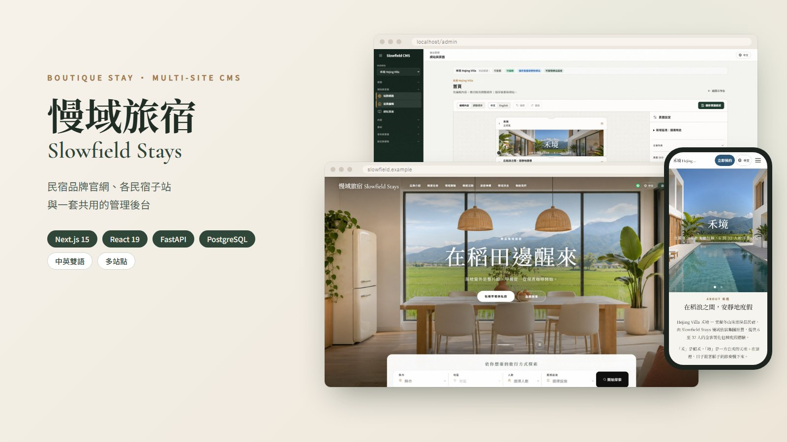
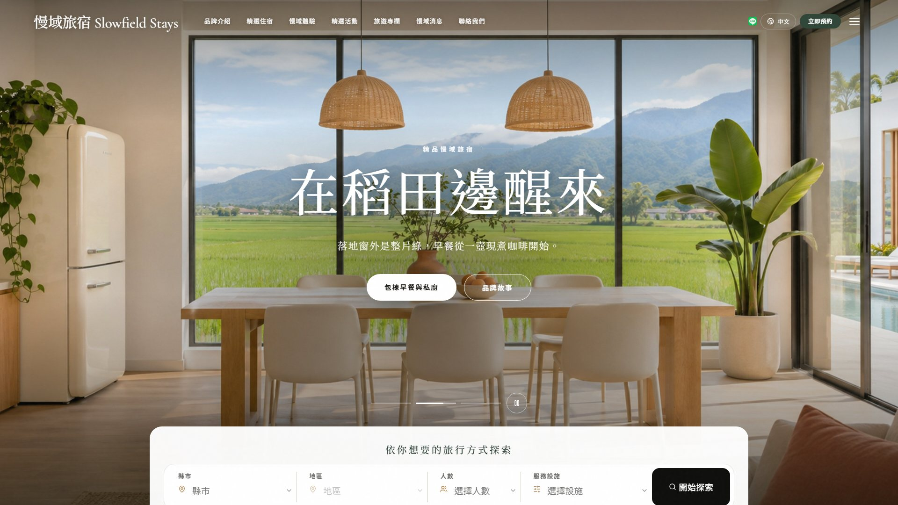
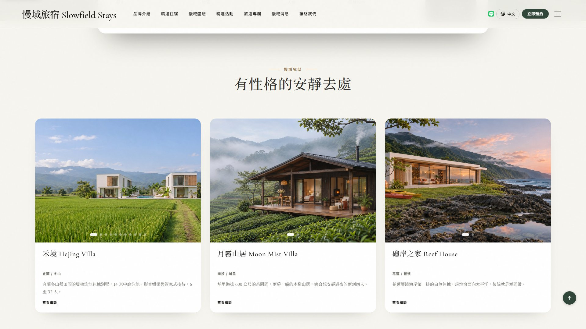
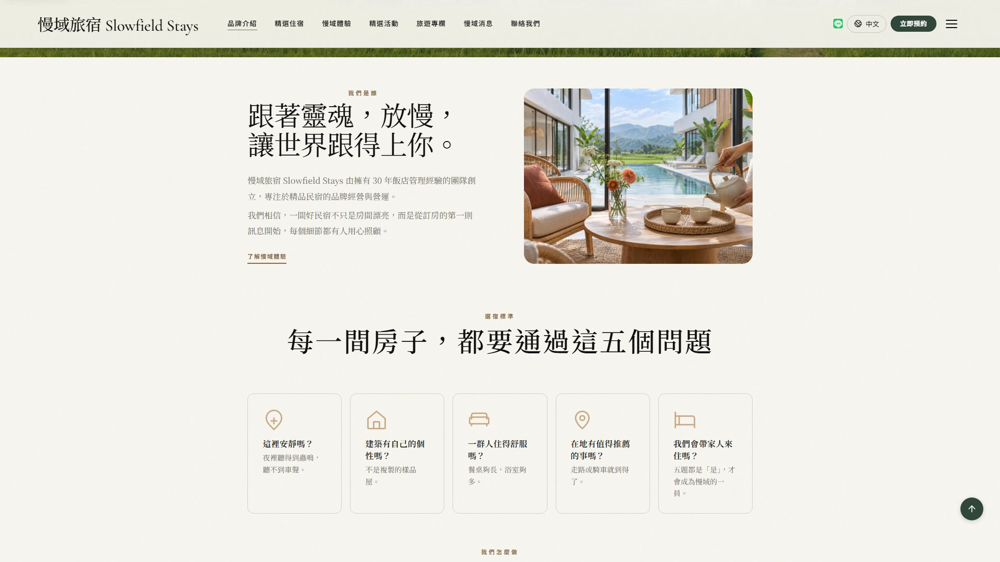
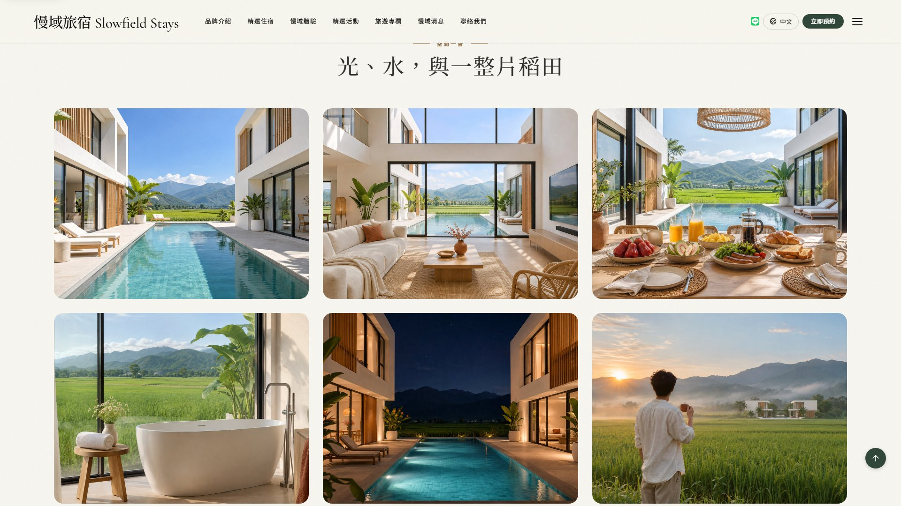
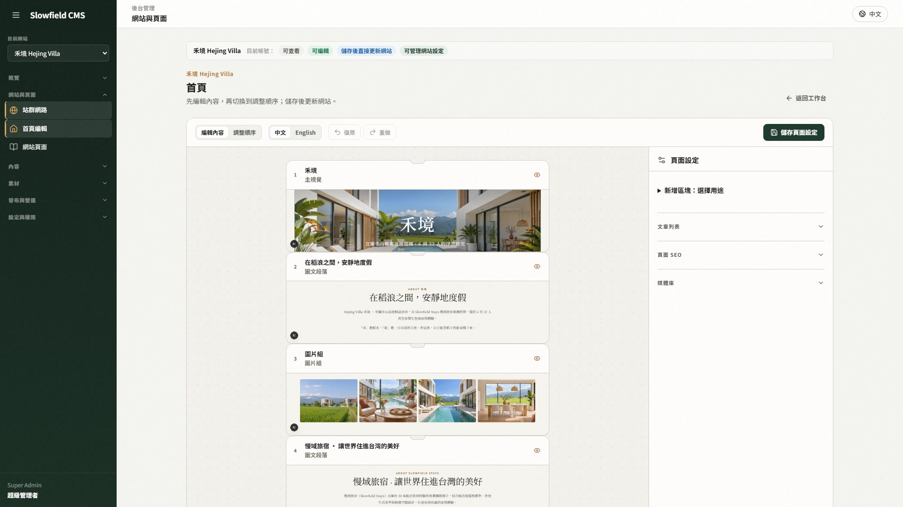

# Slowfield Stays Multi-site Hospitality Website and CMS

[繁體中文](README.md) · [Source](https://github.com/yoAkyoku/slowfield-stays) · [Public-site video](https://github.com/yoAkyoku/slowfield-stays/blob/main/docs/videos/front-walkthrough.mp4) · [Admin video](https://github.com/yoAkyoku/slowfield-stays/blob/main/docs/videos/admin-walkthrough.mp4)

**Type:** Hospitality website and CMS (built as a client project, shown here under a fictional brand)
**Role:** Full-stack Engineer
**Focus:** Multi-site content management · Stay filters · Chinese and English admin UI · Inquiry-based booking

## Overview

A website and content management system built to support multiple hospitality sites. The public website presents the brand, stays and hospitality services. The management platform supports site setup and day-to-day editing of stays, pages, media and marketing content.

The system was built as a client project, and the original site has closed. What is shown here is the same system under a fictional brand, **Slowfield Stays**. The brand, stays, addresses and contacts are demo content, and the photos are AI-generated. There is no live site, so the walkthrough videos show it instead.

- [Public-site walkthrough video](https://github.com/yoAkyoku/slowfield-stays/blob/main/docs/videos/front-walkthrough.mp4) (51 pages, about 4 minutes)
- [Admin walkthrough video](https://github.com/yoAkyoku/slowfield-stays/blob/main/docs/videos/admin-walkthrough.mp4) (40 pages, about 2.5 minutes)
- [Source and more screenshots](https://github.com/yoAkyoku/slowfield-stays)

## Screens

### 1. Brand homepage and stay search

Full-width property imagery with the brand line, site navigation and a search by city, district, guest count and facilities.

### 2. Featured stays

Cards show each stay's photos, location and character, and link to the stay page and its own site.

### 3. Brand page

One page built from content blocks: the brand story, how stays are chosen and how guests are looked after.

### 4. Photo wall

The homepage shows property photos as a wall of equal tiles.

### 5. Admin block editor

The homepage and other pages are built from reorderable blocks, with a live preview beside the editor.

## What I built

- A parent, template and child-site workflow. After creation, each child site can maintain its own content and settings.
- Stay listing and detail pages with room types, pricing text, facilities, FAQs, location and contact details, plus stay filters.
- Chinese and English admin UI. Site content is maintained separately; changing the admin UI language does not translate CMS content.
- CMS workflows for pages, banners, articles and media, with preview, review, publish and archive states.
- An inquiry-based booking flow. Guest requests enter an admin queue where staff can update status, add internal notes and export CSV.
- Newsletter subscriptions and a sending queue, with unsubscribe handling and per-site SMTP settings.

## Engineering decisions

### Booking requests go to an operations queue

The flow collects stay inquiries for staff follow-up. It does not reserve rooms in real time or handle room inventory, online payments, confirmed orders or cancellations; those are outside this release.

### Child sites stay independently editable

A new child site starts from a template, then its copy, images, SEO and settings can be maintained separately. This keeps a shared structure while allowing each brand to manage its own content.

## Technology

Next.js · TypeScript · React · FastAPI · SQLAlchemy · PostgreSQL · Alembic · Docker Compose

## Public scope

The screenshots, videos and source are all of Slowfield Stays, a fictional brand. This case study does not include the original client's brand material, production databases, credentials, secrets or guest information.
