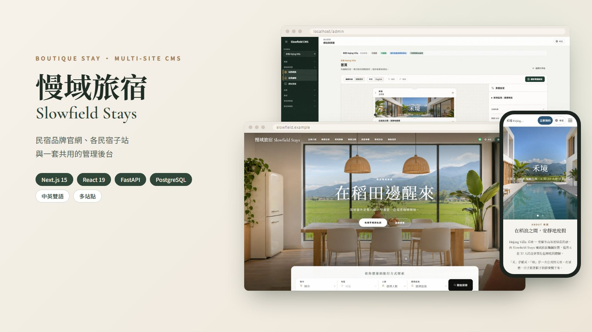
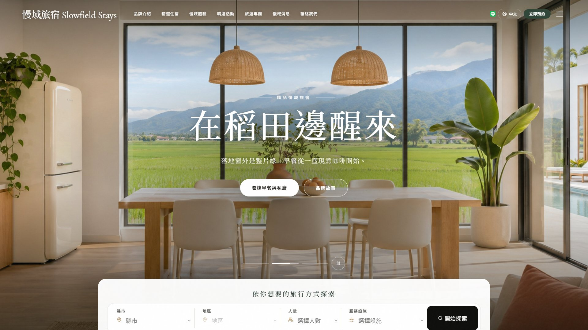
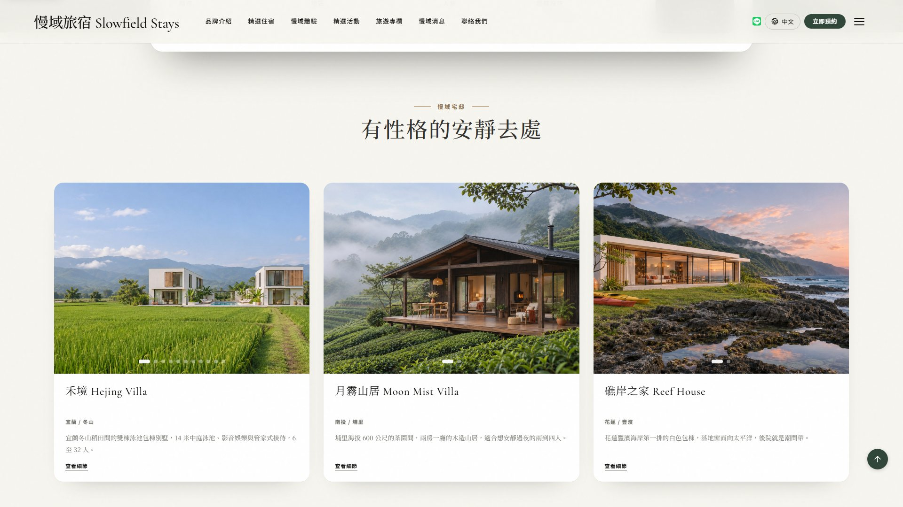
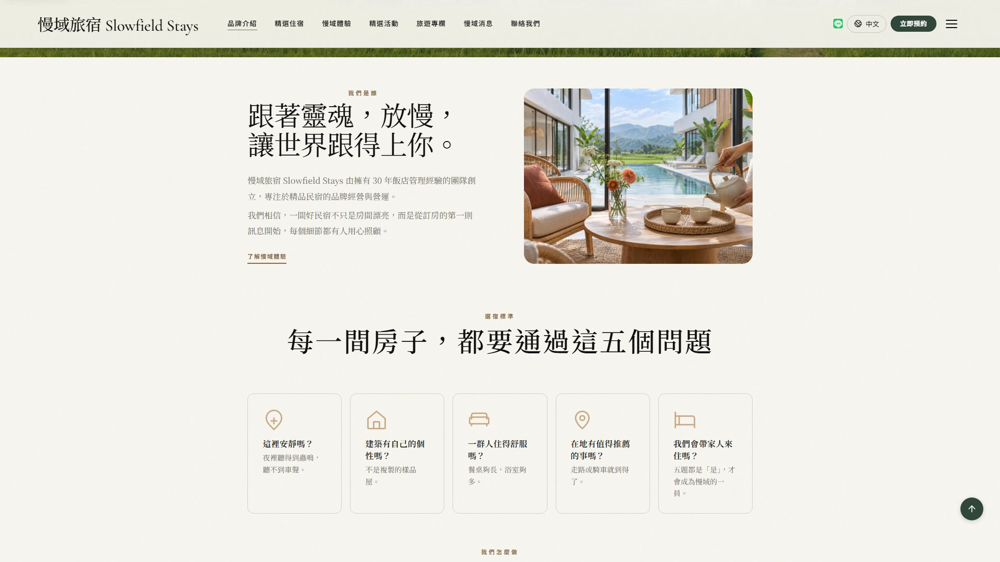
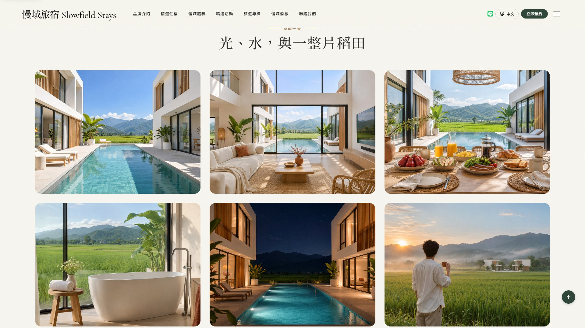
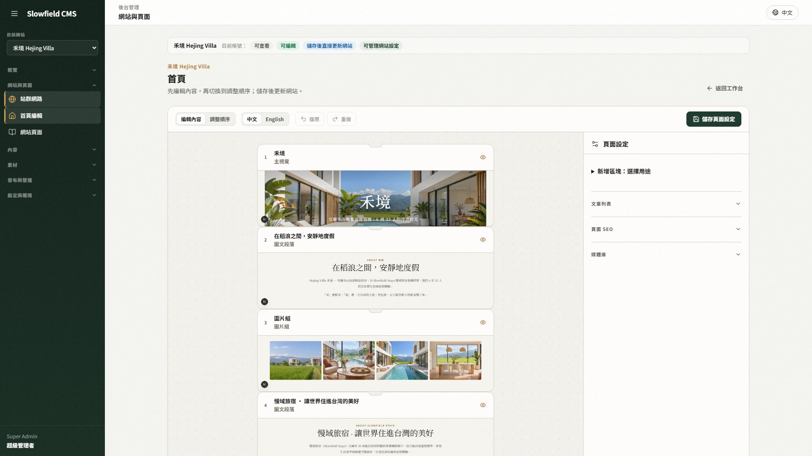

# Slowfield Stays 多站旅宿官網與內容管理系統

[English](README.en.md) · [原始碼](https://github.com/yoAkyoku/slowfield-stays) · [前台導覽影片](https://github.com/yoAkyoku/slowfield-stays/blob/main/docs/videos/front-walkthrough.mp4) · [後台導覽影片](https://github.com/yoAkyoku/slowfield-stays/blob/main/docs/videos/admin-walkthrough.mp4)

**專案類型：** 旅宿網站與 CMS（原為客戶專案，以虛構品牌公開展示）
**角色：** Full-stack Engineer
**重點：** 多站內容管理 · 住宿篩選 · 中英管理介面 · 詢問型預訂

## 專案概覽

為旅宿品牌建立可管理多個站點的網站與內容管理系統。公開官網呈現品牌、住宿與服務資訊；管理平台可建立品牌站點，並維護住宿、頁面、媒體與行銷內容。

這套系統原為客戶專案，原站已關閉。這裡展示的是同一套系統換上虛構品牌 **Slowfield Stays 慢域旅宿** 的版本：品牌、住宿、地址與聯絡方式皆為示範內容，照片由 AI 生成。展示版沒有線上站台，請看導覽影片。

- [前台導覽影片](https://github.com/yoAkyoku/slowfield-stays/blob/main/docs/videos/front-walkthrough.mp4)（51 頁，約 4 分鐘）
- [後台導覽影片](https://github.com/yoAkyoku/slowfield-stays/blob/main/docs/videos/admin-walkthrough.mp4)（40 頁，約 2 分半）
- [原始碼與更多截圖](https://github.com/yoAkyoku/slowfield-stays)

## 畫面

### 1. 品牌首頁與住宿搜尋

全幅旅宿影像搭配品牌標語、網站導覽，以及依縣市、地區、人數與設施搜尋住宿的入口。

### 2. 精選住宿

以卡片呈現各間住宿的照片、地點與特色，連到住宿介紹與各自的子站。

### 3. 品牌介紹單頁

用圖文區塊組成的單頁：品牌故事、選宿標準與服務方式。

### 4. 相片牆

首頁以等寬小圖牆呈現空間照片。

### 5. 後台區塊編輯器

首頁與各頁面由可排序的區塊組成，編輯時右側即時預覽。

## 我完成的範圍

- 建立父站、範本與子站的管理流程；子站建立後，可獨立維護自己的內容與設定。
- 製作住宿列表與詳細頁面，整理房型、價格說明、設施、常見問題、地點與聯絡資訊，並提供住宿條件篩選。
- 提供中文與英文的管理介面；站內內容由管理者分別維護，切換管理介面語言不會自動翻譯內容。
- 建立頁面、橫幅、文章與媒體的 CMS 流程，支援預覽、審核、發布及封存。
- 建立詢問型預訂流程，讓旅客提交需求後由營運人員在後台處理；管理端可更新狀態、加註內部備註及匯出 CSV。
- 加入電子報訂閱與寄送佇列，並提供取消訂閱流程及各站點的 SMTP 設定。

## 設計取捨

### 預訂需求先進入人工處理佇列

這套流程用來收集住宿詢問與安排後續聯繫。它不會即時鎖定房間，也不處理房態庫存、線上付款、正式訂單或取消作業；這些不屬於目前版本的功能範圍。

### 子站建立後各自維護

子站從範本建立後，文案、圖片、SEO 與站點設定可分開調整。這讓品牌能沿用共同結構，同時保留各站營運內容的自主性。

## 技術

Next.js · TypeScript · React · FastAPI · SQLAlchemy · PostgreSQL · Alembic · Docker Compose

## 公開範圍

截圖、影片與原始碼皆為虛構品牌 Slowfield Stays 的展示版。本案例不包含原客戶的品牌素材、正式環境資料庫、帳號、密鑰或住客資料。
